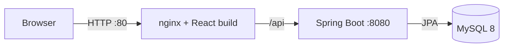

# Architecture

## Backend layers

`Controller` (HTTP, validation) -> `Service` (business rules, transactions) -> `Repository` (Spring Data JPA)
-> `Entity` (table mapping). DTO records (`dto/request`, `dto/response`) keep the API independent of the
entities; `ExpenseMapper` converts between them. `GlobalExceptionHandler` turns exceptions into a uniform JSON error.

Search/filter is built dynamically with a JPA `Specification` (`ExpenseSpecification`), so any combination of
`q`, `category`, `from`, `to` works with paging and sorting. Sort fields are whitelisted.

The dashboard uses aggregate queries for totals and category breakdown and aggregates the last 6 months in Java.

## Frontend

`pages/` are routes; `components/` are reusable UI; `services/` wrap Axios calls; `hooks/` (`useFetch`,
`useDebounce`, `useLocalStorage`); `context/` provides toasts, theme and the category list; `utils/` has
formatters and validators. No Redux: the state is small and local state + context is enough.

## Deployment topology

`docker-compose.yml` runs three containers: `mysql`, `backend` (multi-stage Maven build, non-root JRE) and
`frontend` (Vite build served by nginx, which also reverse-proxies `/api`). Only nginx is published, so the browser
talks to a single origin and no CORS configuration is needed in production.
